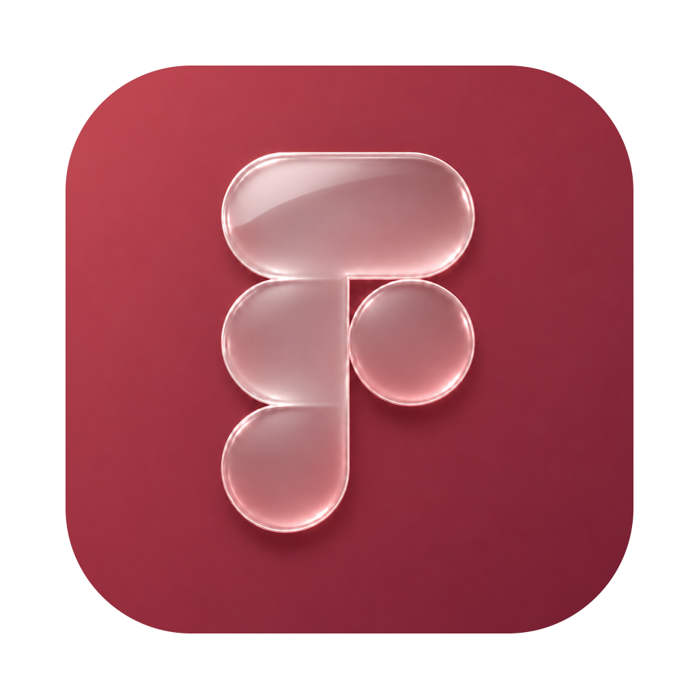

# PoFig

Запускайте официальную Figma через свой прокси на Mac и Windows.

## Скачать

| Для вашего компьютера | Скачать |
| --- | --- |
| Mac, macOS 13 и новее | [PoFig для Mac](https://github.com/bogdanhpk/PoFig/releases/download/v0.1.8/PoFig-macOS.zip) |
| Windows | [PoFig для Windows](https://github.com/bogdanhpk/PoFig/releases/download/v0.1.8/PoFig-win-x64.zip) |
| Windows на ARM | [PoFig для Windows на ARM](https://github.com/bogdanhpk/PoFig/releases/download/v0.1.8/PoFig-win-arm64.zip) |

[Все версии](https://github.com/bogdanhpk/PoFig/releases). Версия для Windows пока предварительная.

## Как начать

1. Установите [Figma](https://www.figma.com/downloads/).
2. Скачайте и распакуйте PoFig. На Mac перенесите `PoFig.app` в «Программы» и откройте его. На Windows откройте `PoFig.exe`, оставив остальные файлы из архива рядом с ним.
3. Нажмите **«Добавить прокси»**. Укажите название, тип, сервер и порт. Если нужны логин и пароль, заполните их.
4. Сохраните прокси и нажмите **«Проверить соединение»**.
5. Полностью закройте Figma и нажмите **«Запустить Figma»** в PoFig. На Mac для выхода из Figma используйте **⌘Q**.

Сервер вводите без `http://` и порта: например, `proxy.example.com`. Для порта есть отдельное поле. Поддерживаются HTTP, HTTPS и SOCKS5.

Если PoFig не нашёл установленную Figma, нажмите **«Выбрать Figma…»**.

## Как пользоваться

После запуска Figma окно PoFig скрывается. Значок остаётся в верхней строке меню на Mac или в трее Windows. После выхода из Figma окно PoFig появится снова.

- **Открыть настройки:** нажмите значок PoFig и выберите **«Показать PoFig»**.
- **Изменить прокси:** дважды нажмите на его строку или выберите её и нажмите **«Изменить»**.
- **Удалить прокси:** выберите строку, нажмите **«Удалить»** и подтвердите действие.
- **Выйти из PoFig:** сначала закройте Figma, затем выберите **«Завершить PoFig»** в меню значка.

Прокси можно менять и удалять при открытой Figma. Изменения применятся при следующем запуске Figma через PoFig. Пароли сохраняются в хранилище паролей вашей системы.

## Если Mac не открывает PoFig

При первом открытии Mac может запросить разрешение на запуск. Следуйте [инструкции для Mac](https://github.com/bogdanhpk/PoFig/blob/main/macos/OPEN-FIRST.txt). Она также есть в архиве под названием **OPEN-MAC-FIRST.txt**.

## Если нет соединения

Проверьте адрес, порт, логин и пароль прокси. После сбоя или обновления Figma полностью закройте её и запустите из PoFig снова.

Прокси применяется к приложению Figma. Окно входа в браузере может использовать другое подключение.

## Автор

Разработчик и создатель — **Богдан Хтоминский**.

PoFig — независимое приложение. Figma — товарный знак Figma, Inc.
